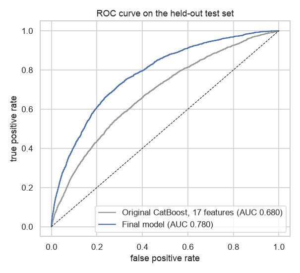
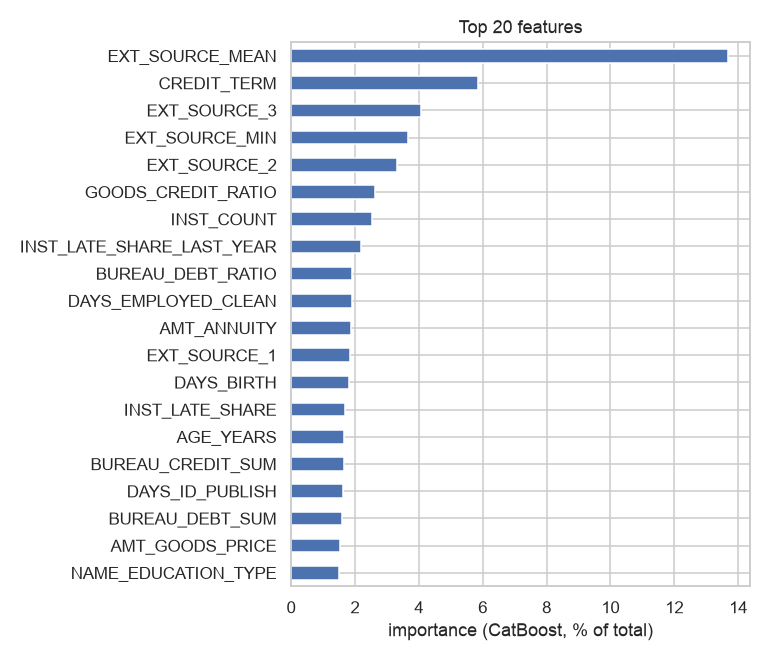

# Home Credit Default Risk

Predicting which loan applicants will have trouble repaying, using the [Home Credit Default Risk](https://www.kaggle.com/competitions/home-credit-default-risk) competition data (307,511 applications, about 8% of which defaulted).

I first worked on this in May 2025 with a simple model on 17 hand-picked columns, and extended it in October 2026 by adding information one step at a time and measuring what each step is worth. The original notebooks are kept in [`legacy/`](legacy).

## Results

Models are early-stopped on a validation set. The held-out test set was scored once per row and never used to choose anything. Metric: ROC AUC (the chance that a random defaulter is ranked riskier than a random non-defaulter; 0.5 is guessing).

| Model | Features | Validation AUC | Test AUC |
|---|---:|---:|---:|
| Decision tree, depth 4 *(first version)* | 17 | 0.622 | 0.624 |
| CatBoost, original settings *(first version)* | 17 | 0.677 | 0.680 |
| CatBoost, tuned settings, same 17 features | 17 | 0.676 | 0.677 |
| + all application columns | 119 | 0.759 | 0.758 |
| + engineered ratios and fixes | 133 | 0.769 | 0.765 |
| + loan history (bureau, installments, credit cards) | 156 | 0.783 | **0.780** |



**What moved the needle**

- **Using the data I'd skipped** took the biggest step (+0.08). The first version left out the three `EXT_SOURCE_*` scores (my original exploration had even plotted one of them) along with about 100 other columns. They turn out to be the strongest signals; see [notebook 1](notebooks/01_exploration_and_split.ipynb).
- **Better settings on the same 17 features did nothing** (row 2 vs 3), so the gain is information, not tuning.
- **Credit history from the customer's earlier loans** added another +0.015: the share of late installments, credit-card utilization, existing debt ratios. Customers who were late on more than half of previous installments default at about 16%, versus 7% for those who never were.
- **Gender added nothing.** The main models exclude it (it is a protected attribute in lending), and adding it back changes test AUC by +0.0002, which is noise. Leaving it out costs nothing here.



Sorted into ten equal groups by predicted risk, the riskiest 10% of applicants default about 3.6 times as often as average and the safest 10% only 0.7% of the time (see [notebook 3](notebooks/03_modeling.ipynb)).

## Notebooks

| | |
|---|---|
| [`01_exploration_and_split`](notebooks/01_exploration_and_split.ipynb) | The problem, missing data, which columns separate defaulters, a data quirk (`DAYS_EMPLOYED = 365243`), and the train / validation / test split |
| [`02_feature_engineering`](notebooks/02_feature_engineering.ipynb) | Engineered ratios and the loan-history aggregates, with checks that nothing leaks the target |
| [`03_modeling`](notebooks/03_modeling.ipynb) | The staged comparison above, ROC curve, feature importance, risk deciles, the gender question, limitations |

The shared code is in [`src/`](src): `features.py` (loading, the split, feature builders) and `experiments.py` (the staged runs, cached so notebooks re-run quickly).

## Run it yourself

The Kaggle data can't be redistributed, so it isn't in this repo. See [`data/README.md`](data/README.md) to download it into `data/raw/`.

```bash
python -m venv .venv && source .venv/bin/activate
pip install -r requirements.txt
python src/experiments.py          # trains every stage (under an hour on a laptop CPU)
jupyter notebook notebooks/        # then run the notebooks in order
```

## Limitations and what's next

- **Selection bias.** Only approved applicants have labels, so the model says nothing about rejected ones.
- **Arbitrary hold-out.** The test set is the highest 10% of applicant IDs, which are not time-ordered. A real evaluation would split by application date.
- **AUC is not a business decision.** Picking a cutoff needs the cost of a default versus the profit on a good loan.
- **Not fully tuned.** Hyperparameters were set once and early-stopped, not searched.
- **Unused tables.** `previous_application`, `POS_CASH_balance` and `bureau_balance` hold more signal. I only used the four tables I had locally.
- **Fairness.** Dropping gender doesn't remove proxies for it (occupation, region, income type); a proper review would compare error rates across groups.
- **About the first version.** Its Keras cell reports 92% accuracy, which is meaningless: it rounds probabilities down to 0, so it predicts "no default" for everyone, and about 92% of borrowers don't default. That's why this project reports AUC.

## License

MIT
